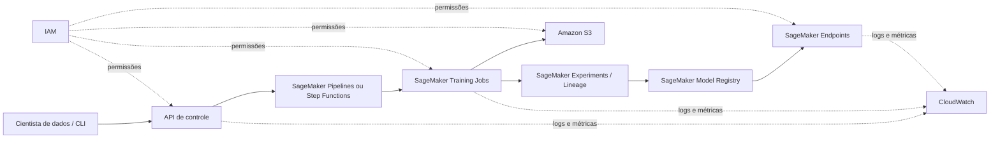

# Evolução conceitual para AWS

Este diagrama descreve opções futuras, não recursos implementados. O MVP é local e não requer
credenciais AWS.

Uma migração exigiria definir identidade e autorização, criptografia e retenção dos dados,
estratégia de build de imagens, limites de custo e operação do endpoint. A escolha entre
Experiments/Lineage, Registry e orquestração deve atender a requisitos concretos da futura
plataforma; este case não replica serviços gerenciados localmente nem os provisiona.
